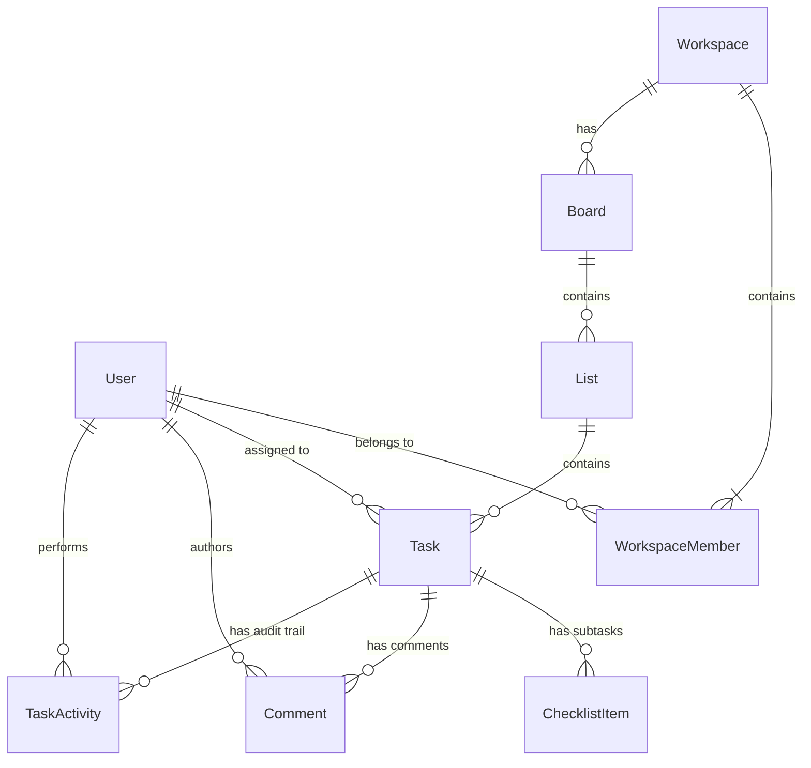

# TeamSync · Real-Time Collaborative Workspace

> A high-performance, real-time project management and collaboration platform engineered with an anti-slop, human-crafted design system. Built with React 19, TypeScript, Node.js, Express 5, PostgreSQL, Redis, Socket.IO, and Docker.

---

##  Highlights & Key Capabilities

- **Multiplayer Real-Time State**: Distributed drag-and-drop presence with peer ghost badges (`"[User] is moving this..."`), instant socket synchronization, and room partitioning over Redis Pub/Sub.
- **Universal Command Palette (`Ctrl + K` / `⌘K`)**: Keyboard-driven fuzzy search across workspaces, boards, task actions, and instant task inspector drawers with full arrow-key and ESC navigation.
- **Hierarchical Checklists & Dynamic Progress**: Granular task subtasks with live progress bar percentage calculations (`2/3 (66%)`) synchronized instantly across connected clients.
- **Live Typing Presence & Comment Streams**: Transient socket typing indicators (`"[User] is typing..."`) and persistent audit trail activities recorded automatically on every mutation.
- **Strict Anti-Slop Design Language**: Built following the curated `dense-tiles` + `graphite-safety-orange` design aesthetic. Zero generic AI-slop tropes (no radial purple gradients, no fuzzy drop shadows, no uppercase micro-labels). Audited with **0 FAILs** against automated design linters.
- **Zero-Downtime Docker Orchestration**: Multi-stage Vite/Nginx frontend container and Alpine Node backend container orchestrating PostgreSQL 16 and Redis 7.

---

### Event Specification

| Event | Direction | Payload | Description |
| :--- | :--- | :--- | :--- |
| `join-board` | Client → Server | `boardId: string` | Joins client to scoped room `board:<boardId>` |
| `leave-board` | Client → Server | `boardId: string` | Leaves room `board:<boardId>` |
| `task:drag-start` | Client ↔ Server | `{ boardId, taskId, user }` | Broadcasts active drag state to peers |
| `task:drag-end` | Client ↔ Server | `{ boardId, taskId }` | Clears active drag state for peers |
| `task:typing` | Client ↔ Server | `{ boardId, taskId, user, isTyping }` | Relays transient comment typing presence |
| `task:updated` | Server → Room | `{ task: Task }` | Emits updated task title/description |
| `task:deleted` | Server → Room | `{ taskId: string }` | Emits task deletion to update board view |
| `task:reordered` | Server → Room | `{ taskId, listId, order }` | Broadcasts reordered task coordinates |
| `task:comment-added`| Server → Room | `{ taskId, comment, activity }` | Broadcasts newly posted comment and audit item |
| `task:checklist-updated` | Server → Room | `{ taskId }` | Signals peers to invalidate checklist cache |
| `notification:new` | Server → User | `{ type, title, message, ... }` | Direct push notification to `user:<userId>` |

---

##  Design Philosophy (Anti-Slop)

TeamSync was crafted to eliminate the pervasive "AI-generated SaaS slop" pattern in modern web applications. Every component adheres to an engineered set of taste rules:

- **Palette**: Monochromatic graphite (`#121212` background, `#1a1a1a` surfaces, `#2a2a2a` borders) with surgical **safety-orange** (`#ff5500`) reserved exclusively for active states, live indicators, and ghost presence chips.
- **Typography**: Clean, geometric `Jost` sans-serif paired with `JetBrains Mono` for metadata, timestamps, and badges.
- **Dense-Tiles Structure**: Information-dense, modular panel architecture designed for power users, ditching massive wasted whitespace and floating glassmorphism cards.
- **Restraint Over Excess**: Zero looping bouncing icons, zero 48px rounded pill buttons, and zero radial purple glow gradients.
- **Automated Verification**: Integrated with automated anti-slop linters (`design-taste-frontend`), maintaining **0 FAILs** across 26 frontend files.

---

##  Relational Data Model

Implemented in PostgreSQL via Prisma ORM:



---

##  Getting Started

### Prerequisites
- **Node.js**: v20 or newer
- **Docker & Docker Compose**: (if running via containers)
- **PostgreSQL & Redis**: (if running natively)

### Local Development

1. **Clone and Install Dependencies**:
   ```bash
   git clone https://github.com/your-username/teamsync.git
   cd teamsync

   # Install frontend dependencies
   cd frontend && npm install && cd ..

   # Install backend dependencies
   cd ts-backend && npm install && cd ..
   ```

2. **Environment Variables**:
   Copy `.env.example` to `ts-backend/.env` and `frontend/.env`:
   ```bash
   cp .env.example ts-backend/.env
   ```

3. **Database Setup**:
   ```bash
   cd ts-backend
   npx prisma db push
   npx prisma generate
   cd ..
   ```

4. **Start Development Services**:
   ```bash
   # Run both servers from root:
   npm run dev:backend    # Runs Express API on http://localhost:5000
   npm run dev:frontend   # Runs Vite on http://localhost:3000
   ```

---

##  Docker Production Deployment

Run the complete multi-container production stack (PostgreSQL, Redis, Express Backend, Nginx-proxied Frontend) with one command:

```bash
docker compose up --build
```

- **Web Application**: Access at `http://localhost` (or `http://localhost:3000`)
- **API Health Check**: `http://localhost:5000/health`
- **Reverse Proxy**: Nginx transparently handles SPA history API fallback, `/api/*` proxies, and WebSocket `/socket.io/*` upgrades.

---

##  Quality & CI/CD Pipeline

The repository includes a strict GitHub Actions workflow (`.github/workflows/ci.yml`) enforcing code health on every commit:

```bash
# 1. Anti-Slop Design Linter
npm run lint:design

# 2. Frontend Production Build & TypeScript Validation
npm run build:frontend

# 3. Backend Typecheck
npm run typecheck:backend

# 4. Docker Compose Syntax Validation
docker compose config --quiet
```

---

##  License
MIT © 
